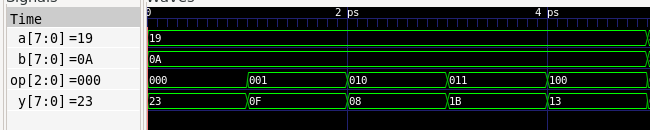

# ALU in Verilog (Verilator)

A 8-bit arithmetic logic unit written in Verilog and verified with a C++ testbench in Verilator, using waveform inspection in GTKWave.

**Project page:** https://michaelcrandall.github.io/projects/verilator-alu/



## Overview

This project implements an ALU in synthesizable Verilog (`alu.v`) and checks it against a C++ reference model in a Verilator testbench (`sim_main.cpp`). The testbench exercises **327,680 test cases** and dumps a VCD waveform that can be inspected in GTKWave.

I built it to practice digital design and simulation-based verification, and as a companion to my discrete-component RTL ALU and my 8-bit Verilog CPU.

## Operations

| `op` | Operation | Description  |
|------|-----------|--------------|
|  000 |   [ADD]   | [a + b]      |
|  001 |   [SUB]   | [a - b]      |
|  010 |   [AND]   | [bitwise AND]|
|  011 |   [OR]    | [bitwise OR] |
|  100 |   [XOR]   | [bitwise XOR]|


**Inputs:** `a` (8 bits), `b` (8 bits), `op` (3 bits)
**Outputs:** `result` (8 bits)

## Verification

- `sim_main.cpp` drives the ALU through every combination of `a`, `b`, and `op` for a total of 327,680 cases.
- Each result is compared against a reference computed in C++.
- "ALU passed all tests!" is all computations match expected results
- A VCD trace is written during simulation and can be opened in GTKWave.

## Requirements

- [Verilator](https://www.veripool.org/verilator/)
- A C++ compiler (g++ or clang++) and `make`
- [GTKWave](https://gtkwave.sourceforge.net/) (optional, for viewing waveforms)

## Build and Run

Build the Verilator model and testbench
```bash
verilator -Wall --trace --cc alu.v --exe sim_main.cpp --top-module alu --build
```

Run the simulation:
```
./obj_dir/Valu
```

Expected output: 
``` 
ALU passed all tests!
```

The run writes `alu.vcd` to the directory you run it from. To inspect the waveform:

```bash
gtkwave alu.vcd
```

## Repository Structure

```
alu_verilator/
├── alu.v              # ALU design
├── sim/sim_main.cpp   # Verilator C++ testbench
├── docs/              # waveform screenshot
├── .gitignore         # ignores obj_dir/ and *.vcd
└── README.
```

## Related Projects

- [4-bit ALU from discrete transistors (RTL)](https://github.com/michaelcrandall/REPO-NAME)
- [8-bit CPU in Verilog](https://github.com/michaelcrandall/REPO-NAME)

## Author

Michael Crandall, B.S. Electrical Engineering, University of Maryland (expected December 2028)
[LinkedIn](https://linkedin.com/in/crandall0327) · [Portfolio](https://michaelcrandall.github.io)
